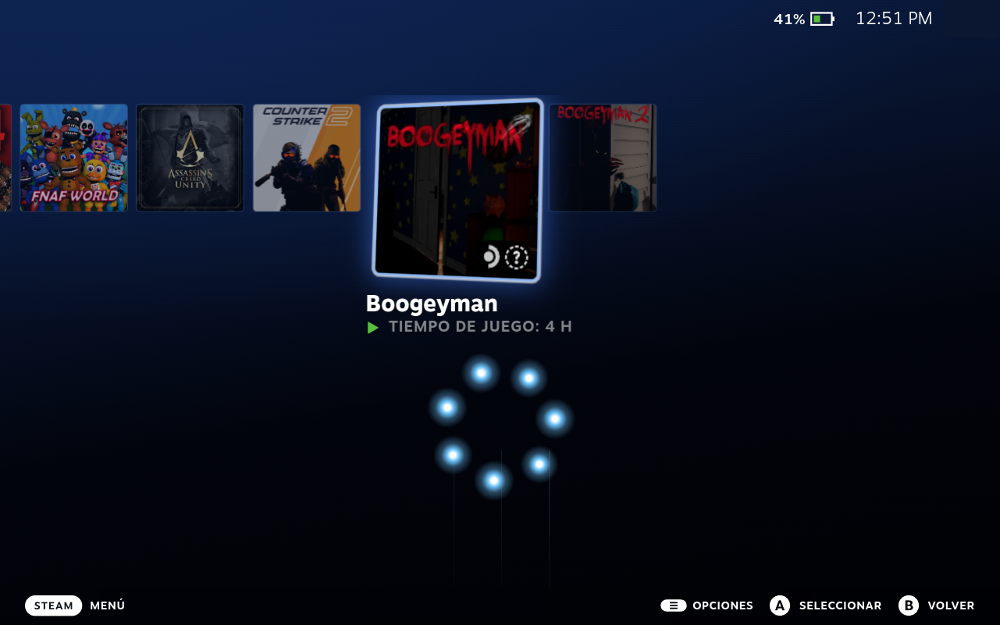
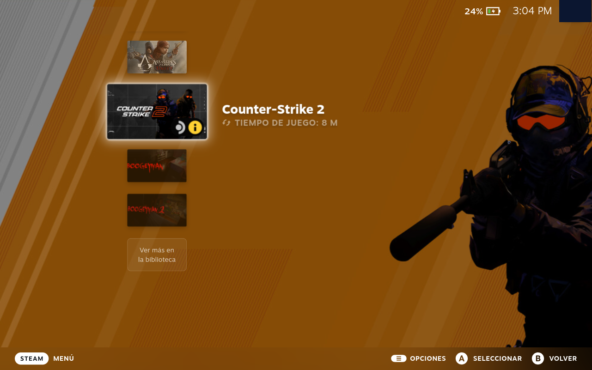
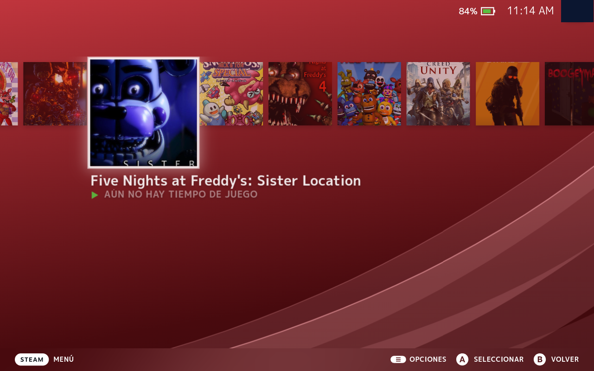
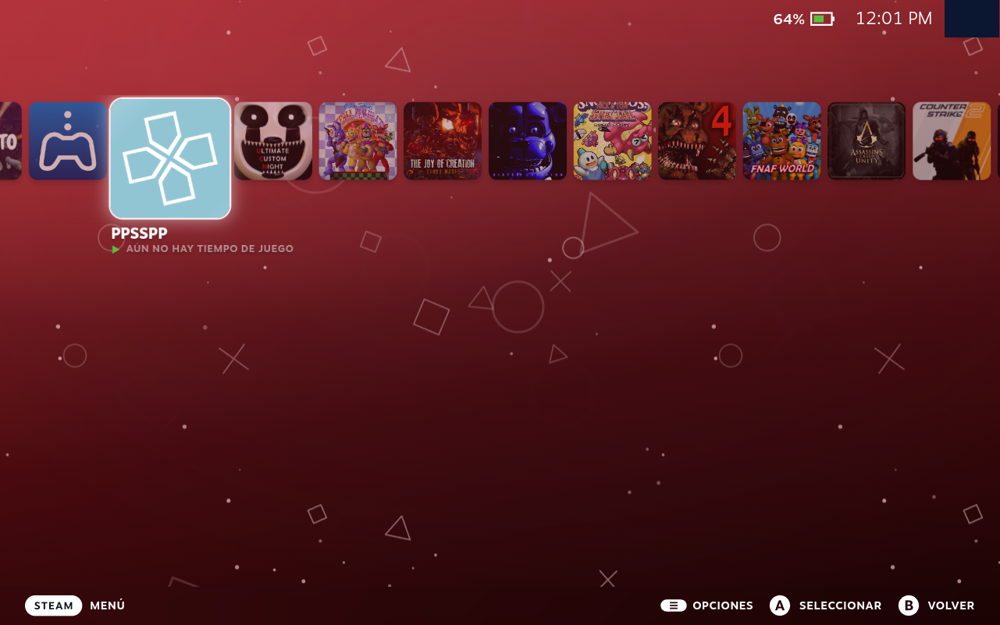

# PS XMB

Plugin de [Decky Loader](https://decky.xyz) que le da a la pantalla de Inicio de la
Steam Deck el aspecto de las consolas PlayStation. Eliges la consola desde el panel
del plugin y cada una trae su fondo animado, sus tarjetas, su color y sus sonidos.

*A Decky plugin that gives the Steam Deck home screen a PlayStation look. Pick PS2,
PS3 (vertical XMB column), PS4, PS5 or Steam Deck; each one brings its own animated
background, game cards, color and sounds. The theme is installed automatically
through CSS Loader.*

| PS2 | PS3 |
|---|---|
|  |  |
| **PS4** | **PS5** |
|  |  |

## Instalar

PS XMB no está en la tienda de Decky; se instala desde el enlace del release:

1. En la Steam Deck abre el menú **···** → **Decky** → ⚙️ **Ajustes** y activa
   **Modo desarrollador**.
2. En **Desarrollador**, elige **Instalar plugin desde URL** y pega:

   ```
   https://github.com/ProjectsConsoles/PS-XMB/releases/latest/download/PS-XMB.zip
   ```

3. Confirma. Abre el panel de **PS XMB** en el menú de Decky y elige tu consola.

*Install: Decky → Settings → enable Developer mode → Developer → Install plugin from URL,
and paste the link above.*

Para actualizar, repite los mismos pasos con el mismo enlace.

## Consolas

| Consola | Fondo animado | Tarjetas | Sonidos / música |
|---|---|---|---|
| PS2 | Anillo de 7 orbes azules (como el menú de la PS2) | Íconos 3D que giran | PS2 System Sounds / PS2 Ambience |
| PS3 | Ola del XMB | Columna vertical con íconos horizontales; se maneja con arriba/abajo | XMB / PS3 Menu Music |
| PS4 | Arcos "Flow" o partículas | Cuadradas, la seleccionada crece | PS4 |
| PS5 | Símbolos △○✕□ | Redondeadas; la imagen del juego de fondo por 10 s | PS5_Sounds |
| Steam Deck | — | Portadas verticales normales | Los de Steam |

En PS3 y PS5, al seleccionar un juego su imagen aparece de fondo (1 minuto en PS3,
10 segundos en PS5) y luego vuelve el fondo animado.

## Qué se necesita

- **[CSS Loader](https://github.com/DeckThemes/SDH-CssLoader)** (obligatorio): es el que
  muestra el tema. El tema PS XMB lo instala el plugin solo.
- **[Audio Loader](https://github.com/EMERALD0874/SDH-AudioLoader)** (opcional): para los
  sonidos y la música de cada consola. Los paquetes se bajan desde su tienda; el panel
  del plugin muestra cuáles faltan.
- **Clave de [SteamGridDB](https://www.steamgriddb.com/profile/preferences/api)**
  (opcional, gratis): para portadas cuadradas y horizontales que no se vean recortadas.
  Se pega en el panel del plugin.

## Panel del plugin

- **Tema:** consola y color de fondo.
- **Más opciones del tema:** el resto de las opciones de CSS Loader (color de las olas,
  juego a pantalla completa, brillo, letra), en un apartado que se abre y se cierra.
- **Extras:** sonidos por consola, controles de la columna de PS3 y portadas automáticas.
- **SteamGridDB:** clave y botón para actualizar portadas.
- **Lo que se necesita:** qué está instalado y qué falta.

## Cómo funciona

- El tema vive en `defaults/tema/PS XMB` y se copia a `~/homebrew/themes` al arrancar,
  sin tocar la configuración del usuario. Para que se actualice hay que subir la
  `version` de su `theme.json`.
- La consola y el color se cambian por medio de CSS Loader (`set_patch_of_theme`).
- En segundo plano (`main.py`) el plugin:
  - cambia el paquete de Audio Loader según la consola y regresa el color a
    "Automático" al cambiar de consola (`sonidos/sonidos_por_modo.py`);
  - en PS3 convierte arriba/abajo en el movimiento de la columna
    (`controles/xmb_vertical.py`), por el puerto de depuración de Steam;
  - baja portadas de SteamGridDB para los juegos nuevos
    (`portadas/portadas_cuadradas.py`).
- `herramientas/` tiene los generadores de los fondos animados de PS2 y PS5.

## Compilar

```sh
pnpm install
pnpm run build
```

## Créditos

- La página del juego a pantalla completa se basa en
  [Clean Gameview](https://deckthemes.com/themes/view?themeId=a9776f60-2724-4ff0-824b-e1f82a04688e)
  de SuchMeme (MIT).
- Los paquetes de sonidos son de sus autores en la tienda de Audio Loader; no se
  incluyen en este repositorio.

PlayStation, PS2, PS3, PS4, PS5 y XMB son marcas de Sony Interactive Entertainment.
Este proyecto no está afiliado ni respaldado por Sony. Los fondos son dibujos
originales; no incluye material de Sony.

Licencia MIT.
